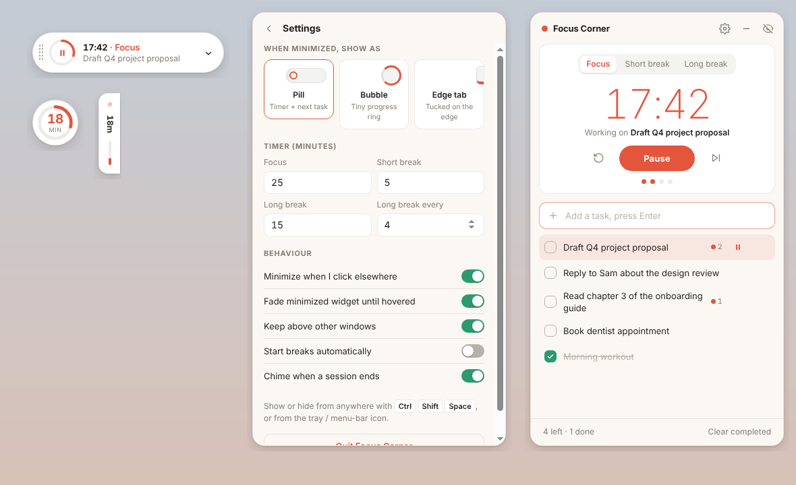

# Focus Corner

A small desktop widget that floats in the top-right corner of your screen: a to-do list and a Pomodoro timer in one place. It stays above your other windows, minimizes to something tiny, and hides completely when you want a clean screen.

Built with **Electron**, so the same code runs on macOS, Windows and Linux.



## Download

Get the installer for your computer from the **[latest release](https://github.com/Kari6688/focus-corner/releases/latest)**: `.dmg` for Mac, `.exe` for Windows, `.AppImage` for Linux.

## Release a new version

Bump `"version"` in `package.json` (for example `1.0.0` → `1.0.1`), commit, and push to `main`. GitHub Actions builds all three installers and publishes them as release `v1.0.1` (see `.github/workflows/release.yml`). Pushes that don't change the version don't create a release.

## Run it from source

You need [Node.js](https://nodejs.org) (the LTS version is fine).

```bash
cd focus-corner
npm install      # one time: downloads Electron
npm start        # opens the widget in the top-right corner
```

## Turn it into a real installable app

```bash
npm run dist:mac     # → dist/Focus Corner-1.0.0.dmg      (run on a Mac)
npm run dist:win     # → dist/Focus Corner Setup 1.0.0.exe (run on Windows)
npm run dist:linux   # → dist/Focus Corner-1.0.0.AppImage
```

Build each on its own operating system. Install it like any other app, then turn on **Open when my computer starts** in Settings so it's always there.

> **macOS note:** the app isn't signed with an Apple Developer ID yet. The first time you open it, macOS says it can't verify the app: click **Done**, then go to **System Settings → Privacy & Security** and click **Open Anyway**. After that it opens normally.

## How it works

| State | What you see | How to get there |
|---|---|---|
| **Minimized** | A small widget in the corner | Click **–** in the panel, press **Esc**, or just click somewhere else |
| **Expanded** | Timer + full to-do list | Click the minimized widget |
| **Hidden** | Nothing on screen (tray / menu-bar icon only) | Click the eye icon in the panel |

**Bring it back from anywhere:** `Ctrl + Shift + Space` (Windows/Linux) or `⌘ + ⇧ + Space` (Mac), or click the tray / menu-bar icon.

### Minimized styles (Settings → "When minimized, show as")

- **Pill** — shows the countdown and your next task. The ring is a play/pause button, so you can start a session without opening anything.
- **Bubble** — a tiny circle with a progress ring: minutes left while a timer runs, or how many tasks are left.
- **Edge tab** — a slim tab tucked against the right edge of the screen, with a progress bar.

### Other options in Settings

- Minimize automatically when you click elsewhere
- Fade the minimized widget until you hover over it
- Keep above other windows (or not)
- Start breaks automatically
- Chime when a session ends
- Custom focus / break lengths and how often the long break comes

### Tasks + timer together

- Press **▶** on a task to start a focus session on it. Each finished session adds a dot count next to that task, so you can see how long things really took.
- Double-click a task to edit it. Completed tasks drop to the bottom; **Clear completed** removes them.
- The widget remembers your tasks, timer and position between launches. Drag it by the grip on the pill or the panel's title bar, and it will stay where you put it ("Move back to top-right corner" in the tray menu resets it).
- On a Mac, the countdown also shows in the menu bar while a session runs.

## Project layout

```
main.js          The window: always-on-top, frameless, pinned to the corner; tray; global shortcut
preload.js       Safe bridge between the UI and main.js
renderer/
  index.html     The widget's markup (pill, bubble, edge tab, panel, settings)
  styles.css     Look and feel; light & dark mode follow your system
  app.js         To-do list, Pomodoro timer, saving, notifications
assets/          Tray / menu-bar icons
build/icon.png   App icon used when packaging
```

Want to tweak the look? Open `renderer/index.html` directly in a browser — it works there too (without the window tricks), which is handy for styling.
